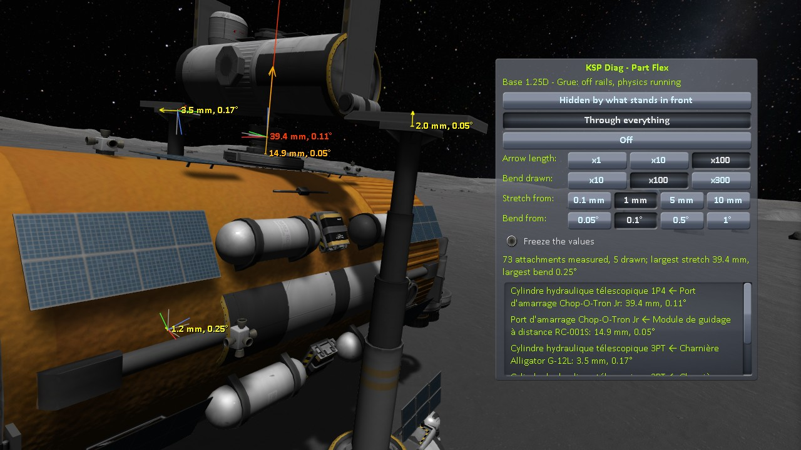

# KSP Diag - Part Flex

**⚠️ Work in progress.** This is an active investigation, not a finished mod. The code and this page can still change, and several questions are still open.

A viewing instrument for KSP 1.12. In flight, it shows how far the physics moves each part of the active vessel
from where its parent holds it: at the node that joins the two parts, how far that node has moved from where
it should be — the stretch of the attachment — and by how much the part has turned — its bend. Each
attachment beyond a threshold gets an arrow for the stretch, two sets of axes for the bend, and its values
written next to them. A small window lists them by part and parent.

**How this was made.** Written with Claude, Anthropic's AI assistant, and reviewed line by line by a
human — me. I am saying so up front, because contributions made with an AI deserve a closer look than
others, and because some people would rather stop reading here. That look is easy to give here: the source
is about twelve hundred lines with no dependency of any kind, and the mod changes nothing in the game. It
reads the joints the game sets up between the parts, and the pose of the bodies they link.

## What it shows

*KSP 1.12.5 with KSP Community Fixes: a crane on the Mun holding a tanker by a piston and two docked ports,
loaded from a save, time warped to the morning, then left to settle. Drawn through everything, arrows a
hundred times as long as the stretch, axes turned by a hundred times the bend.*

**An arrow per stretched attachment.** It starts where the node should be, given where the parent is, and
ends where the node is, as long as the stretch, or ten or a hundred times as long, as chosen in the window.
A small cross marks its start, seen even when the arrow is too short to be. Its colour goes from yellow, for
no stretch, to red, for 5 cm and more.

**Two sets of axes per bent attachment.** Both start where the node should be. The grey ones point where the
part should point, given where the parent is; the red, green and blue ones (its x, y and z) point where the
part points, turned by ten, a hundred or three hundred times the bend, as chosen in the window, and by 90° at
most: a bend of a tenth of a degree would not show otherwise.

**Its values** are written next to where the node should be: the stretch in millimetres, the bend in
degrees. Two attachments a few centimetres apart, such as two docked ports, get their values one under the
other.

Nothing is drawn for an attachment below both thresholds of the window: the physics leaves fractions of a
millimetre at almost every one.

## What it measures

The game holds each part to its parent by a joint of the physics, set up when the vessel is put together:
on loading, when two vessels dock, when a part is added. `PartJoint.SetupJoint` gives the joint two anchors,
one on each body, at the same point; the joint pulls its two bodies back to the pose they had then, the
anchors together. The mod measures how far they are from that pose.

- **The pose the joint rests in.** The game keeps the anchors, not the rotation of one body in the frame of
  the other when the joint was made. The mod takes it the first time it sees the joint, at a frame or a
  physics step, before the physics moves the bodies: on loading, the joints are made while the vessel is on
  rails, and nothing moves. When it saw the joint too late, the anchors were already apart, and the window
  says so (see [The window](#the-window)).
- **The bend** is the angle between where the body of the part points and where it should point, given
  where the body of the parent is and the pose the joint rests in.
- **The stretch** is measured at the node that joins the part to its parent, the node of the part: how far it
  is from where it should be, given where the body of the parent is and the pose the joint rests in. The game
  does not always anchor the joint at that node: for a robotic part, `PartJoint.SetupJoint` reads the node in
  the frame of the moving part of the servo, and the anchors can be far from the node. Where the part has no
  node towards its parent, as a docked port towards the other, the stretch is measured at the anchors.
- **Which attachments**: the attachment of each part of the active vessel to its parent, docked ports
  included. A part without physics has none: it rides the body of its parent.

## When it measures

The mod measures right after a physics step, ten times a second: where the physics has the bodies. The
drawing follows the vessel at every frame, and keeps the place it was measured at, in the frame of the
vessel.

*Freeze the values* stops the measures: the drawing and the window stay as last measured, and still follow
the vessel. The scales and the thresholds still apply to them.

## The window

The window opens at the top left of the screen, under the clock, and can be dragged. `Alt+F6` hides it, and
shows it again; the drawing goes on.

- **The active vessel** and whether it is *on rails* or *off rails, physics running*.
- **Three modes.** *Hidden by what stands in front*, the default: an arrow inside a part does not show.
  *Through everything*: all drawn on top of the scene. *Off*.
- ***Arrow length***: *x1*, *x10*, the default, or *x100* the stretch.
- ***Bend drawn***: *x10*, *x100*, the default, or *x300* the bend.
- ***Stretch from*** and ***Bend from***: the thresholds. An attachment is drawn and listed when either its
  stretch or its bend reaches its threshold; its arrow only when the stretch does, its axes only when the
  bend does. *1 mm* and *0.1°* by default.
- ***Freeze the values***, see [When it measures](#when-it-measures).
- **A line that sums up**: how many attachments are measured and drawn, the largest stretch and the largest
  bend.
- **The list of the attachments drawn**: `part ← parent`, by their titles, with the stretch and the bend,
  the largest stretch first. `(rest taken late, `*n*` mm off)` follows an attachment whose rest pose the mod
  took after the physics had moved its bodies by that much: its values are measured against that pose.

The mode, the scales, the thresholds and the place of the window are kept from one flight to the next until
KSP is closed. The mod writes nothing to `KSP.log`, but an error if the shader it draws with cannot be
found.

## Taking a reading

Bring a vessel into flight — load a save, for instance, or switch to a vessel of the tracking station — and
let the physics run until it settles. The window lists the attachments the physics has moved, and the
drawing shows where they are. *Through everything* shows the joints hidden inside the parts; *x100* makes a
few millimetres visible.

Some situations change what a reading says. For instance:

- **A vessel that has not settled** swings: the values follow it. *Freeze the values* keeps one set of them.
- **On rails**, the game holds every part where the vessel puts it, and the physics moves nothing: the
  values are those of the poses the game holds.
- **A servo that moves** carries the parts attached to it: that is not a stretch of their attachments, and
  is not shown. The joint of the servo itself, between its two halves, is not measured either: its part
  action window says how far it is from its target.
- **An attachment made in flight**, by docking for instance, rests in the pose of that moment, whatever the
  vessel was like before.
- **Autostruts and struts** are not measured: what they hold or push shows in the attachments of the parts
  they hold.

## Driving it by script

With [KSP-Util-MCPServer](https://github.com/lhervier/KSP-Util-MCPServer) installed next to it, this mod
offers its window to a program, as tools of that server: a script presses its buttons and reads what it
shows, as a player would. Without the server, this mod runs the same.

| tool | what it does |
|---|---|
| `partflex_read` | reads what the window shows, without writing anything: the active vessel and whether it is on rails, the mode, the scales, the thresholds, whether the values are frozen, how many attachments are measured, and the attachments drawn — or every one measured, with `all` set to `true` — largest stretch first, each with its part and parent (title and flight id), the stretch in mm and the bend in degrees, the same against the poses of the save, how far apart the anchors were when the rest pose was taken and whether the vessel was on rails then, and how far the anchors are from the node |
| `partflex_set_display` | chooses how the drawing is made, as the modes of the window do: `0` *Hidden by what stands in front*, `1` *Through everything*, `2` *Off* |
| `partflex_set_arrow_scale` | chooses how long the arrows are, as *x1*, *x10* and *x100* do: `1`, `10` or `100` |
| `partflex_set_bend_scale` | chooses how far the coloured axes are turned, as *x10*, *x100* and *x300* do: `10`, `100` or `300` |
| `partflex_set_thresholds` | chooses the stretch in mm and the bend in degrees from which an attachment is drawn and listed, as *Stretch from* and *Bend from* do, but taking any value from `0` |
| `partflex_freeze` | ticks or unticks *Freeze the values*, as clicking it does |
| `partflex_move_window` | moves the window, as dragging it does: `x` and `y` in pixels from the top left corner of the screen; returns its position and size |
| `partflex_show_window` | shows or hides the window, as `Alt+F6` does; the drawing goes on either way |

## Get it

Either way you end up with the same `GameData/KSPDiagPartFlex/` folder.

**Download it** — from the assets of the
[latest release](https://github.com/lhervier/KSP-Diag-PartFlex/releases/latest).

**Or compile it** — clone this repository, set `KSPDIR` to your KSP install folder and run
`build.bat`. It needs the .NET SDK and
[KSP-Util-MCPServer](https://github.com/lhervier/KSP-Util-MCPServer) installed in that KSP, takes a few seconds,
reads the KSP assemblies straight from your install, and puts the DLL in
`GameData/KSPDiagPartFlex/` inside the repository. It does not install anything.
KSP-Util-MCPServer is only needed to compile: it provides the attribute that marks what this mod offers to
it, and this mod runs the same without it. Worth doing if you would rather not run a binary you have no source for while
reporting what you saw.

## Install

Drop `GameData/KSPDiagPartFlex` into the `GameData` of KSP, so that you end up with
`GameData/KSPDiagPartFlex/KSPDiagPartFlex.dll`. It runs on a stock install:
no Harmony, no ModuleManager, no dependency of any kind.

The window is there in every flight. The mod only reads: it changes nothing in the game, and your saves are
never touched. Removing the folder removes the mod.

## License

MIT
